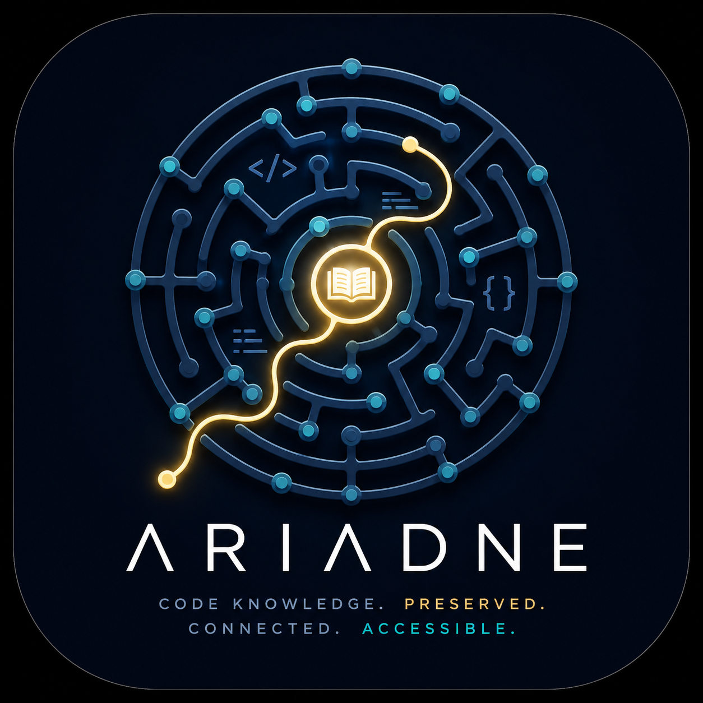
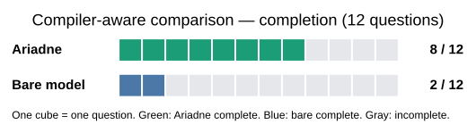

<p align="center">
  
</p>

# Ariadne

A compiler-grounded knowledge base for LLM agents. Ariadne indexes a codebase, generates concise documentation, and serves source-backed results over MCP so an agent can navigate code without rediscovering its structure on every question.

> **License: [Apache 2.0](LICENSE).** Free to use, modify, and redistribute, including commercially.

## Why Ariadne?

Normal code search starts from strings and files. Ariadne also uses [SCIP](docs/scip-cross-source.md): compiler-derived identities, definitions, call sites, ownership, and cross-language relationships. It combines that structure with generated documentation and semantic search, then keeps changed files current rather than rebuilding the whole corpus.

## A reviewed compiler-aware comparison

The public comparison uses twelve difficult, target-pinned questions about Spark 4.0.0 and Delta 4.0.0. Ariadne receives compiler-derived relationships and source evidence; the bare LLM receives ordinary source reads and text search. A completed question must satisfy every required source-backed claim.

<p align="center">
  
</p>

| Reviewed measure | Ariadne | Bare LLM |
| --- | ---: | ---: |
| Completed questions | **8 / 12** | **2 / 12** |
| Canonical symbol IDs emitted | 112 / 121 (93%) | 0 / 121 (0%)¹ |
| Definitions | 109 / 122 (89%) | 74 / 122 (61%) |
| Relation sites | 88 / 97 (91%) | 26 / 97 (27%) |
| Witness fragments | 159 / 187 (85%) | 114 / 187 (61%) |

¹ The bare run did not emit machine-readable canonical SCIP IDs, so this is a format-limited lower bound, not a completion criterion. Its two completed answers qualified through verified target repository paths, exact source quotes and line locations, and complete directed explanations. These results apply to this reviewed panel only.

- [Comparison report](evaluation/chain-benchmark/COMPILER_AWARE_COMPARISON.md)
- [Public panel record](evaluation/chain-benchmark/compiler-aware-comparison-record.json)
- [Offline verifier](evaluation/chain-benchmark/verify_compiler_aware_comparison.py)
- [Minimal target source-root builder](evaluation/chain-benchmark/build_compiler_aware_source_root.py)

## What it provides

- **Compiler-grounded navigation.** Exact symbol lookup, callers/callees, ownership, impact analysis, and cross-source relationships for supported languages.
- **Generated, searchable documentation.** Explanations, architecture notes, Q&A, gotchas, diagrams, and Leiden-discovered themes.
- **MCP access.** A single SQLite-backed library for Claude Code and other MCP-enabled agents, scoped to the codebase and its declared dependencies.
- **Predictable spend.** `dry-run` estimates generation cost before any paid work; git-aware sync refreshes only changed files.
- **Version-pinned spools.** Optional knowledge packs ground questions in a target system's own source, such as a Databricks runtime.

## Supported models

| Suite | Documentation and synthesis | Embeddings | Verification |
| --- | --- | --- | --- |
| OpenAI cloud | GPT-6 Astra (`gpt-6-astra`) | OpenAI `text-embedding-3-large`, 3072 dimensions | 24/24 live workflow checks passed |
| Anthropic cloud | Claude Opus 5.5 (`claude-opus-5-5`) | OpenAI `text-embedding-3-large`, 3072 dimensions | 24/24 live checks passed after the latest retrieval fix |
| Hosted Qwen | DeepInfra `Qwen/Qwen3.8-27B` | DeepInfra `Qwen/Qwen3-Embedding-8B`, 4096 → normalized 3072 dimensions | Production provider and shared workflow regression tests |
| Local Qwen | `Qwen/Qwen3.8-27B` | `Qwen/Qwen3-Embedding-8B`, 4096 → normalized 3072 dimensions | Application integration and recovery tested; actual GPU/vLLM qualification pending |

See [supported model configurations](docs/supported-models.md) for exact YAML, credentials and switching commands. Select configurations with `ARIADNE_CONFIG` and give each model pair a separate main/staleness database pair. Existing cloud defaults are unchanged; choose the named models explicitly.

Hosted Qwen verification passed 41 implementation checks across six fresh cases; its earlier factual failure remains recorded. [Live evidence](docs/live-model-verification.md) covers all three model suites. The [50-question retrieval benchmark](docs/retrieval-verification.md) measures Qwen/OpenAI embeddings and passage delivery, not chat-model answer accuracy.

The browser offers OpenAI, Claude, hosted Qwen and configured local Qwen in onboarding's Preview step. Compare costs and adjust scope before choosing **Start build**; only then is the pair saved for the project's library, search and answers. All hosted pairs run through one application container. See [onboarding model selection](docs/supported-models.md#choose-models-during-onboarding) for credentials and local endpoint setup.

### Local inference

The [local Qwen suite](docs/local-models.md) uses separate chat and embedding servers and needs no cloud keys. Keep each model pair in its own library and staleness database. [Clew route building and embedding](docs/local-models.md#clews) use the same configured pair.

Start with [ariadne.local.yaml.example](ariadne.local.yaml.example) and the [local models guide](docs/local-models.md). Local batches are durable foreground jobs managed with `ariadne batch list/status/resume/cancel/clear`; previews make no inference requests. Provider token charges are zero; hardware/runtime costs are unestimated. The [pinned deployment candidate](deployments/local-v1/README.md) still requires [GPU qualification](docs/local-model-qualification.md).

`ariadne doctor --models` checks both configured model identities and tokenization endpoints before generation.

### Docker and browser

For the Docker application image and ready-to-use cloud/local configuration, see [Docker usage](docs/docker.md). The public image retains its web UI, MCP server and SCIP toolchains, with cloud/local presets and explicit CLI commands. Add the documented web Compose override to use either model pair from the browser; the [Qwen container journey](web/e2e/README.md) verifies the application with HTTP model fixtures and no paid inference.

## Quick start

```bash
git clone https://github.com/AvivAvital2/ariadne.git
cd ariadne
uv sync

# Register a source, inspect projected cost, then build the library.
uv run ariadne source add myproject --path /path/to/myproject/src
uv run ariadne dry-run -i --source myproject
uv run ariadne onboard --source myproject
```

OpenAI and Claude generation need `OPENAI_API_KEY` for embeddings and either Anthropic or OpenAI for documentation generation; hosted Qwen needs only `DEEPINFRA_API_KEY`, and the local Qwen pair requires no cloud keys. `onboard` previews cost and asks before paid work. For MCP integration with Claude Code:

```bash
cd /path/to/your-project
uv run --directory /path/to/ariadne ariadne init --source myproject
```

## Learn more

- [First-run walkthrough](docs/new-project-onboarding.md)
- [Configuration](docs/configuration.md)
- [CLI command reference](docs/commands.md)
- [MCP tools](docs/mcp-tools.md)
- [SCIP and cross-source indexing](docs/scip-cross-source.md)
- [Architecture](docs/architecture.md)
- [Environment spools](docs/building-a-databricks-spool.md)

## License

[Apache License 2.0](LICENSE)
